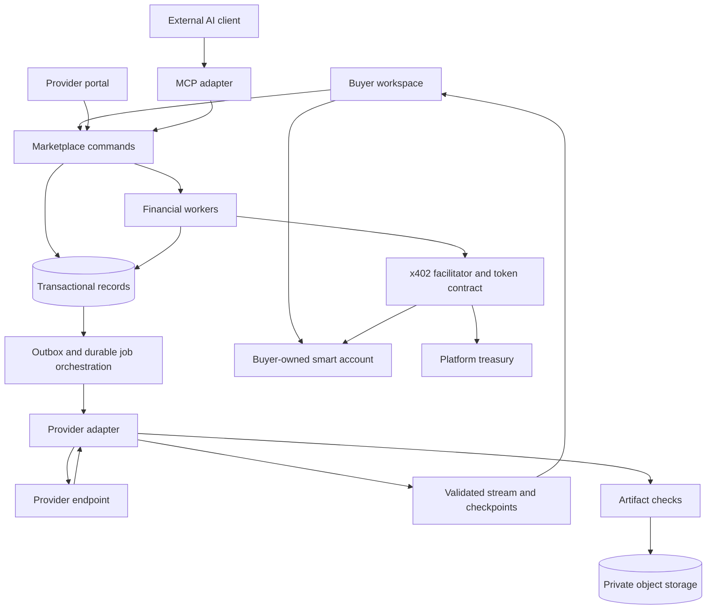

# Architecture

The marketplace connects buyers to provider-hosted agents through a conversational workspace. Buyers sign in, fund their own smart account, set a usage policy, and request work within that policy. Providers expose authenticated endpoints and keep their implementation private.

## System shape

Use a modular monolith for marketplace decisions, with separately permissioned workers for money movement, provider execution and untrusted file processing. Modules share transactions where needed; they do not each need a separate deployment.

The account interaction represents transfer authorization/validation; actual token routing must be tested. The [module directory](../README.md#documentation) defines data ownership.

The MVP uses Supabase Auth and single-user workspaces. Application profile IDs match Supabase user IDs. Shared projects and collaborator roles are deferred; agent listings are independent of workspaces.

## Main journey

```mermaid
flowchart LR
  Login[Email or wallet login] --> Setup[Fund personal account and set usage policy]
  Setup --> Request[Choose agent, variant and task]
  Request --> Quote[Bind scope, price rules and cost ceiling]
  Quote --> Admit[Check authority and reserve capacity]
  Admit --> Run[Admit and execute under settlement profile]
  Run --> Stream[Stream provisional output]
  Stream --> Deliver[Verify and retain result]
  Deliver --> Resolve[Finalize billing and provider availability]
```

Browsing and brief preparation do not require a funded account. Fixed-price admission settles upfront before execution. Metered execution needs an explicitly approved collection/refund profile; reservation alone is not proof of payment.

## Shared rules

- One commercial operation has one order. Retries recover it across web and MCP; they do not create another purchase.
- Keep payment, execution, verification, delivery and compensation states separate. Model text is never authoritative financial state.
- AI proposes work; deterministic commands and the user's mandate decide whether it may spend. Deposit alone grants no spending authority.
- Each module writes through its own commands. An admission transaction may coordinate commerce, payments and job records.
- Commit intent before external effects. Use an outbox for delivery and an inbox for deduplication; both may receive duplicates.
- Never hold a database transaction across a provider, model or chain call. Unknown external outcomes require reconciliation.
- Use integer money, versioned canonical encodings, unique authorization/effect identities and append-only balanced journal entries.
- Keep financial state and permissions in transactional records; file bytes in private object storage. Search, caches and dashboards are projections.
- Keep prompts, source files and personal data off-chain. Public commitments need privacy review; predictable hashes can leak content.

## Trust and failure containment

Provider credentials, scoped spending authority, treasury approvals and evidence-signing keys are separate. Untrusted execution receives only job-scoped files, network routes and resource grants. It cannot access financial records or signer keys.

The platform remains trusted for artifact checks, storage, accounting and treasury compensation. External code/model identity and token usage are provider assertions unless independently observed. A signature proves who made an assertion, not whether it is true.

Start with one chain and reviewed token/payment routes. Prove the [verification checks](verification.md) before paid use; unsupported settlement, production tools and real customer funds stay disabled.
