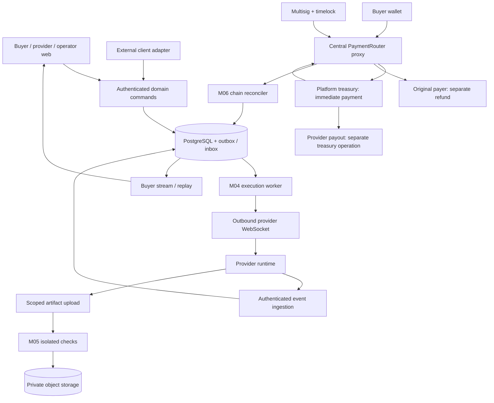

# Architecture

**Target specification, not deployed architecture.** Product choices and unresolved approvals are in [scope](product/scope.md).

## System shape

Use a modular monolith for authoritative application decisions, PostgreSQL for transactional records, and separately permissioned workers for chain reconciliation, provider dispatch and untrusted artifact checks. Provider infrastructure remains external. No distributed service per module is required.

The treasury-to-router arrow is a scoped refund allowance and `transferFrom`, not an escrow balance. The proposed treasury is the direct recipient. A refund fails if it cannot fund the transfer. Treasury solvency is an operational obligation with admission and payout gates.

## Ownership and source of truth

| Concern                                   | Owner | Authoritative record                                   |
| ----------------------------------------- | ----- | ------------------------------------------------------ |
| User status, membership, wallet proof     | M01   | Auth identity plus application authorization records   |
| Brief, message, attachment ownership      | M02   | Versioned application records; private object bytes    |
| Scope, quote, order and commercial policy | M03   | Immutable quote and order transitions                  |
| Runtime assignment, leases, capacity      | M04   | Durable run/attempt and reservations                   |
| Output checks, delivery and acceptance    | M05   | Artifact revisions, evidence and buyer decision        |
| Successful payment/refund                 | M06   | Canonical contract state/logs, then reconciled journal |
| Listing/version and admission evidence    | M07   | Immutable manifest and approval record                 |
| Client grant and transport                | M08   | Scoped client authorization; no separate order state   |
| Dispute, review, incident                 | M09   | Evidence-backed case and operator actions              |

Only an owning module changes its records. Cross-module admission may use a single database transaction; chain and provider calls occur outside that transaction. Financial journals are projections of verified effects, not evidence that an effect happened.

## Main financial and execution boundary

1. M03 persists a canonical quote and order; M06 issues a signed payment ticket bound to that order and payer.
2. Buyer approves the token if needed and calls `pay`. The router transfers directly to the pinned treasury and records the order's payment atomically.
3. M06 indexes canonical state with chain-specific finality, checks all bindings and appends balanced journal entries once.
4. M03/M04 atomically activate paid access, create one run and enqueue dispatch. No execution from a browser receipt or an unfinalized log.
5. M04 receives provisional progress; M05 validates and makes the result accessible. M03 records commercial completion after acceptance or the stated review policy.
6. M09 may approve a refund; M06 executes a separately funded transfer and reconciles it. Payout discharges eligible provider earnings independently.

No two-phase commit spans the chain and database. A chain payment can exist while the application is unavailable: reconciliation must recover it. A paid order that cannot execute remains a funded obligation, never silently disappears.

## Consistency, identity and event rules

- Stable `operationId`, `orderId`, `runId`, `attemptId`, `eventId` and financial effect identities survive retries and restarts.
- Persist intent before dispatch. Use transactional outbox and deduplicating inbox; delivery is at-least-once, not exactly-once execution.
- Ordering is local to a stream/aggregate, not global. Attempt leases fence late results. An uncertain provider side effect requires recovery, not blind retry.
- Payment, execution, delivery, acceptance, refund and payout have distinct states. There is no generic `success` that stands for all of them.
- Chain effects use `(chainId, contract, txHash, logIndex)` plus unique order/refund business keys. Keep block hash and finality status for reorg reconciliation.
- Immutable terms pin versions. Catalog edits, role rotation or price changes cannot silently retarget existing paid work.
- Database backups never undo on-chain transfers. Restore in read-only financial mode, reconcile, then reopen admission.

## Trust boundaries

Provider text, schemas, URLs, files and model outputs are untrusted. Listing text cannot grant tools or payment authority. Providers receive only admitted inputs and short-lived file grants for their assigned attempts. They never receive buyer sessions, wallet signatures, refund approvals or treasury keys.

Contract code enforces payment/refund bindings and replay limits. It does not evaluate AI quality, run agents, verify off-chain file availability or guarantee treasury reserves. Platform verifiers and dispute operators remain trusted; governance can upgrade logic and therefore carries disclosed custody risk.

Public chain data includes payer, recipient, token, amount and opaque order references. Keep prompts, personal identifiers and raw artifacts off-chain. Use a randomly salted commitment to private terms and retain the salt privately; a public deterministic hash of predictable content can disclose information.

## Deployment and policy boundaries

Release one uses one chain/token profile and pinned dependencies, with versioned runtime protocol and schema. Environment-specific addresses, finality policy, fee limits, capacity and retention are release configuration requiring evidence in [verification](verification.md). Unknown profiles fail closed.

Separate permissions for application API, provider Gateway, artifact processors, payment-ticket signing, refund approval, refund relay, payout and upgrades. An API compromise must not directly expose treasury or upgrade credentials.
