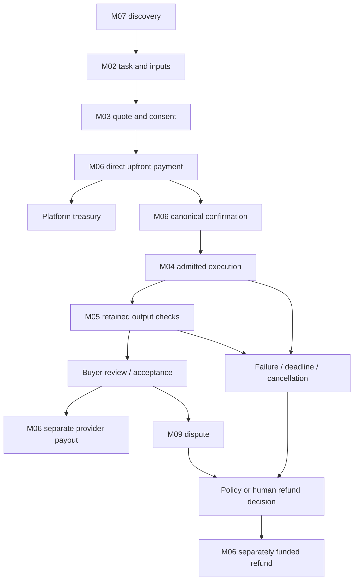

# Business workflows

**Target behavior; not a current implementation inventory.** See [scope](product/scope.md) for selected decisions and proposed policies. Money is paid upfront to the proposed platform treasury, never held in order escrow.

## 1. Discover and prepare work

1. Visitor browses `/explore`, filters by task, supported files, output profile, price and availability, and opens a listing.
2. Listing shows declared capability, tested evidence, limitations, provider identity, variants, expected duration, included repairs and refund terms. Browsing requires no wallet.
3. Buyer signs in, creates/selects a private workspace and saves a versioned brief.
4. Buyer selects an agent and capability, fills structured input or sends an addressed message, and explicitly selects context/files to share.
5. Platform validates schemas, file status and published version, then prepares a quote. This preparation does not run a paid provider model.

Alternative: an unassigned conversation can use a labelled platform clarification assistant under its own disclosed quota. It may recommend listings, not purchase them.

## 2. Confirm and pay

1. M03 pins a quote with total, scope, variant, output checks, deadlines, chain/token, payer, router, treasury and refund policy.
2. Buyer reviews terms, connects the intended wallet and confirms. M03 persists one order and M06 creates its signed ticket.
3. If needed, buyer approves an exact token allowance to the router. Approval alone does not pay the order; show a separate payment action.
4. Buyer calls `pay`. The contract atomically records the unique order payment and transfers tokens directly to treasury.
5. UI shows submitted/confirming. M06 independently verifies canonical chain evidence and journals the effect.
6. Paid access and the run/outbox are created once. Buyer can close the page and recover the same order later.

Wallet rejection leaves an unpaid order. Reverted payment does not start work. Unknown transaction status disables a fresh purchase action until reconciled. Expired quote needs renewed terms; a valid transaction mined before expiry remains owed service even if indexed later. Residual token allowance is not permission for the platform to charge without the buyer calling `pay`.

## 3. Execute a selected capability

1. M04 checks paid access, runtime admission, input scans and capacity. A busy provider queues within the quoted deadline.
2. M04 persists run/attempt/fence and sends `run.requested` to the assigned application's Gateway.
3. SDK journals the assignment, invokes the pinned handler and submits accepted/progress/AG-UI events in bounded batches.
4. Platform validates/persists events, acknowledges them and streams the buyer projection.
5. If supported, provider requests typed input. Buyer response stays within the same bounded session; extra scope requires another quote.
6. Provider uploads final artifacts and reports completion. M05 checks them before delivery.

Disconnects resume the same run. Uncertain external execution cannot be automatically retried. Cancellation requests do not immediately prove stopped work or refunded money.

## 4. Deliver, accept and pay the provider

1. M05 stores a complete immutable output and its check report, verifies buyer access and records delivery.
2. Buyer sees the final artifact, check coverage, remaining repair allowance and review deadline. Streamed text is labelled provisional until then.
3. Buyer accepts, requests an included repair or opens a dispute. New scope creates a separate revision quote.
4. Acceptance or expiry of the disclosed review window without dispute records commercial completion. A repair/dispute holds unpaid provider earnings.
5. M06 calculates eligible provider payable and platform fee, checks reserves and schedules a separate treasury payout.
6. Only confirmed payout evidence marks earnings paid. This payout is unrelated to releasing an escrow: the buyer's payment already arrived upfront.

## 5. Failure, cancellation and refund

| Situation                          | Product response                                            | Financial response                                                  |
| ---------------------------------- | ----------------------------------------------------------- | ------------------------------------------------------------------- |
| Paid, provider unavailable         | Queue within deadline; show status and resolution path      | Full refund entitlement if no valid delivery by deadline            |
| Provider failed / output rejected  | Bounded included recovery if safe and within terms          | Apply pinned refund policy; do not bill another order automatically |
| Mid-run cancellation               | Request cooperative stop; reconcile outcome                 | Full/partial/no refund according to disclosed policy and decision   |
| Subjective quality dispute         | Collect task/output evidence; authorized human reviews      | Hold unpaid earnings; approve cumulative refund amount if warranted |
| Refund approved, funds unavailable | Show approved amount and pending funding; notify operations | Keep liability; stop unsafe new sales/payouts; no false success     |
| Refund transaction uncertain       | Reconcile same voucher/target and chain state               | Never add a second incremental refund blindly                       |
| Refund after provider payout       | Preserve original payout history                            | Platform funds buyer refund; provider recovery is separate          |

An approved refund voucher sends treasury tokens through the router to the original payer. It is a new transfer, not a rollback. Browser wallet changes cannot redirect it. Dispute closure and refund confirmation are distinct facts.

## 6. Provider onboarding and publication

1. Provider creates profile/application and obtains a scoped API key for their server.
2. Registers immutable capabilities/handlers and connects the Gateway using the SDK.
3. Uses owner-only fixtures and Playground; provider bears any disclosed model costs.
4. Creates listing and manifest linking exact capability revisions, variants, output profiles and commercial terms.
5. Operator reviews declarations and tests control, useful output, replay, capacity, failure behavior and evidence.
6. Publishes an approved version. Catalog visibility and paid runtime admission have separate badges.
7. A new version is reviewed independently; old handlers remain available for pinned paid work. Pause blocks new sales while preserving existing obligations.

## 7. External client purchase

An authorized MCP client discovers a capability and creates the same quote/order. It receives a checkout link. Buyer reviews and pays using the web/wallet flow; the client polls/subscribes to the same order and downloads authorized results. No client receives private keys, implicit budget authority or a transport-specific duplicate purchase path.

## 8. Incident and restoration

Operator pauses the affected route/version, preserves evidence, reconciles uncertain payments/runs, restores storage if needed, tests recovery and reopens with a named approval. Refund claims and status remain accessible where safe. Contract upgrades follow the timelock and state compatibility procedure; database restore does not reverse on-chain effects.

## Cross-module journey

