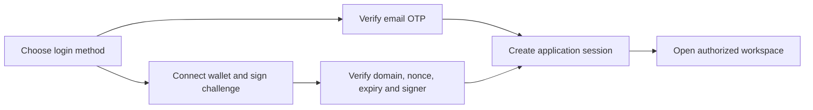

# M01 Identity and Access

Owns accounts, sessions, wallet bindings, project memberships and application grants. Spending authority belongs to [M06](06-smart-accounts-and-payments.md).

Implementation status: the backend provides Supabase email/EOA-wallet login, application-level identity linking, session admission/revocation, profiles and project membership APIs. See the [backend setup and limitations](../../apps/backend/README.md#identity-api-m01). Client grants, support access, smart-wallet authentication and complete wallet/payment compatibility remain unimplemented or unverified; the requirements below remain the target.

## Login and linking

Support email and wallet login, with MetaMask as the primary wallet experience. No social login. Email OTP is the proposed email method.

Connecting a wallet is not authentication. A login signature proves control without transferring tokens or granting usage authority. Challenges are single-use, time-limited and bound to the intended domain; contract-wallet signatures require the correct chain validation path. Rate-limit OTP/challenge attempts and expire or revoke sessions.

A signed-in user can add an email by OTP or a wallet by signature. Verify the new method and the current session. If it already belongs to another account, report a conflict; do not silently merge accounts. Wallet replacement must not redirect old refunds or account ownership.

## Access rules

- Every conversation, quote, job and artifact belongs to an account/project. Check the requested action on every read, write, subscription and export.
- Collaborators may read or draft changes according to their role. Membership does not grant permission to spend.
- Resource IDs, payment hashes and stream cursors do not grant access. Preview sharing grants only its stated preview scope.
- Keep buyer, provider, operator, verifier and financial-approver privileges separate. Log time-limited support access.
- Revoke application sessions/client scopes separately from on-chain delegation; show both states accurately.

## Wallet readiness

Login does not create a smart account or require a deposit. Paid use adds wallet binding and the [payment setup](06-smart-accounts-and-payments.md#personal-account-and-usage-policy).

Validate chain, wallet selection, owner/payer identity and supported methods before requesting financial authority. Never request seed phrases or private keys. Test MetaMask and at least one other named EVM wallet on the complete deposit/policy/payment/recovery path. List mobile, hardware and smart-wallet variants separately; unsupported paths fail without weakening policy.
