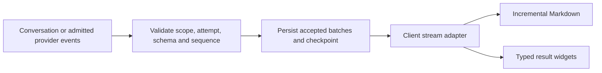

# M02 Workspace and Conversation

Owns projects, briefs, conversations, message parts, interactions and stream checkpoints. A coordinator discovers agents and prepares work; [M03](03-commerce-and-pricing.md) and [M06](06-smart-accounts-and-payments.md) authorize purchases.

For the MVP, each workspace/conversation has one owner identified by their Supabase user ID. Shared projects, invitations and collaborator roles are deferred. Project-scoped requirements below describe the later design, not implemented collaboration.

## Conversation and controls

Users describe a task, answer questions, select an agent/model variant and review the scope. Free clarification has disclosed quotas. A message alone must not become a purchase; automatic starts require an explicit user mandate covering that action and cost ceiling.

Agent manifests can declare forms, choices, buttons and result layouts. The platform renders a registered widget catalog, not arbitrary provider scripts. Each interaction binds principal, project, originating block, action, resource, expected version and operation key. Check authority and staleness again on receipt; repeated clicks recover the same operation.

Selections may draft a revision. They cannot secretly approve a changed price or extend a spending policy. Payment, usage and job-status widgets use authoritative records. Controls need keyboard access, labels, focus handling and clear approval/error states.

## Streaming

Use a framework-independent ordered message/part model. AI SDK UI Message Stream over SSE is a proposed client adapter, not a requirement to use that library inside provider code. Provider protocols, including LangChain streams, need tested adapters. [M04](04-jobs-and-provider-execution.md) owns upstream recovery.

Text parts have stable IDs and start/delta/end events. Data parts carry versioned structured values or checked artifact references. Strip private reasoning and debug traces. Provider tools/approval events never become executable platform commands.

Render only an admitted Markdown subset. Block raw HTML, unsafe URLs, unregistered components and unrestricted attributes, including global component-resolution fallbacks. Images follow [artifact access](05-artifacts-and-verification.md), not arbitrary external fetches. Auto-closing unfinished syntax is display-only; preserve original text. Bound plugins and leave incomplete diagrams/code as safe text when necessary.

## Reconnect and context

Persist snapshots with exact sequence/revision and a bounded event tail. Resume with a gap-free snapshot/tail/live handoff. An expired cursor causes an explicit reset that replaces partial client state. Reauthorize every subscription, deduplicate events and reject stale attempt generations. Disconnect does not cancel a job; message completion does not prove delivery.

Batch deltas and bound text/frame size, buffered data, stream duration and subscriptions. Test partial UTF-8/JSON, proxy flushing, heartbeats, idle timeouts, slow readers and process restarts. Reconnect must not duplicate messages, start provider work or charge again.

Keep context project-scoped and label user instructions, provider output and external references. Imported content cannot become policy or privileged instructions. No automatic cross-buyer memory. Future persistent memory needs provenance, write/retrieval permissions, deletion and delayed-attack tests.

## Papers used

- [AgentDojo, v3](https://arxiv.org/abs/2406.13352v3): test both useful output and unauthorized effects under prompt injection. Previously read §§3.1, 4.3; its attack suite is not a complete defense.
- [Poison Once, Exploit Forever, v2](https://arxiv.org/abs/2604.02623v2): external content can poison later interactions. Previously read §§2.1–2.2 and Appendix A.1; provenance and summaries are controls to test, not proven cures.
