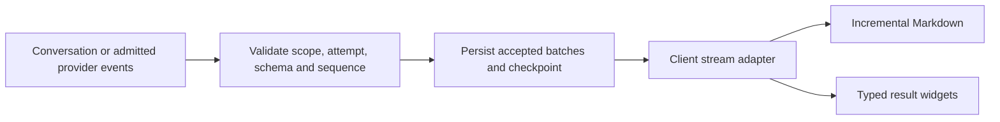

# M02 Workspace and Conversation

Owns projects, briefs, conversations, message parts, interactions and stream checkpoints. A coordinator discovers agents and prepares work; [M03](03-commerce-and-pricing.md) and [M06](06-smart-accounts-and-payments.md) authorize purchases.

For the MVP, each workspace/conversation has one owner identified by their Supabase user ID. Shared projects, invitations and collaborator roles are deferred. Project-scoped requirements below describe the later design, not implemented collaboration.

## Implementation status

The initial M02 slice implements private workspaces, versioned briefs, conversations, persistent text turns, and an **assistant-ui + AG-UI over SSE** chat at `/workspace`. A workspace is the MVP's project container; there is no second project entity.

The responder is deterministic and explicitly labelled **development-only**. It makes no model calls, discovers no agents, executes no provider work, and cannot authorize purchases. A whole development turn and its ordered internal events are committed atomically before its text is streamed in paced chunks. This is durable replay of an already-completed response, not a long-running agent implementation.

Implemented safeguards include owner checks on every command/read/subscription, Supabase profile suspension checks, run/message idempotency, original-text preservation, provenance labels, restricted Markdown, bounded history/events, and reset-to-snapshot recovery. History and its revision use one repeatable-read database snapshot.

Still pending: a real clarification coordinator and disclosed quotas, arbitrary interactive widgets, commercial provider event/attempt adapters, ongoing AG-UI provider-run snapshot/tail/live handoff, and production proxy/slow-reader/restart verification. M03/M04/M05/M06 remain separate dependencies; the owner-only command flow below does not make the commercial target design complete.

### API and replay contract

- `GET/POST /v1/workspaces`: list (50 per page, `offset`) or create using a client-generated UUID.
- `PATCH /v1/workspaces/:id/brief`: replace a brief with its expected `revision`. Stale changes conflict; an exact retry of the last replacement recovers it.
- `GET/POST /v1/workspaces/:id/conversations`: list (50 per page, `offset`) or create a conversation using a client-generated UUID.
- `GET /v1/conversations/:id`: canonical AG-UI message projection, conversation revision, and responder label.
- `POST /v1/conversations/:id/runs`: accept AG-UI-shaped input and commit one development turn. Only the final plain-text user message is admitted; preceding browser messages/state are not authoritative. Tools/context are not accepted for execution. The returned `runId` identifies the existing operation.
- `GET /v1/conversations/:id/runs/:runId/events?after=N`: authenticated, read-only SSE replay. Each complete event has an integer SSE `id`; `after` is exclusive and scoped to that run. The frontend's fetch transport reconnects here, never by starting a new run.

The wire subset is `RUN_STARTED`, `TEXT_MESSAGE_START`, `TEXT_MESSAGE_CONTENT`, `TEXT_MESSAGE_END`, and `RUN_FINISHED`. The database owns framework-independent messages/parts/events; the HTTP adapter projects AG-UI. The AG-UI packages are pinned to `0.0.59` to match the assistant-ui adapter's supported client, rather than mixing incompatible 1.x and 0.x types.

Run and user-message IDs bind the same original input: an exact retry returns the original turn, and changed input or key reuse returns `409`. Conversations cap at 100 turns, messages at 4,000 characters, and briefs at 8,000. Event tails retain the latest four turns; older canonical messages remain available. An expired/out-of-range cursor returns `X-Stream-Reset: true` and `RUN_STARTED → MESSAGES_SNAPSHOT → RUN_FINISHED`, replacing client state rather than appending it. Subscriptions are capped at three per user per backend process and 30 seconds; these are implementation safety bounds, not a commercial quota policy.

The frontend sends only the new user message instead of uploading its transcript. Its replay adapter bounds SSE parsing at 4 MiB (including a full bounded snapshot), closes partial display blocks on reset, and suppresses a duplicate run start. After a reset run settles, the chat runtime is rebuilt from the canonical history endpoint: assistant-ui's active text accumulator would otherwise overwrite the imported snapshot. Browser regression coverage exercises this replacement, not just event receipt. This completed-run recovery does not implement ongoing provider-run recovery.

There are no provider events, private reasoning, image downloads, HTML rendering, custom component fallbacks, or executable tool calls in this slice. Links are HTTPS-only; unfinished fenced blocks remain inert code. A disconnected stream does not remove the saved turn. `RUN_FINISHED` is not job delivery or settlement.

### Owner-only slash command development

The workspace composer recognizes `/` and exposes reviewed, published, unpaused Gateway v2 listings **owned by the signed-in user**, not arbitrary public agents. Keyboard selection or the Commands button opens a schema-generated form. Running requires explicit model-expense confirmation; a normal message, autocomplete selection or page reload never grants execution.

The [M04 Gateway](04-jobs-and-provider-execution.md#implemented-development-gateway) owns invocation persistence, provider delivery and result state. Each invocation has nullable conversation/listing-version references, a pinned command revision, exact input, deadline and stable ID. The backend checks conversation and provider ownership before reads/writes, validates the current published version for new IDs, and recovers existing IDs without retargeting them when registration/publication changes. No credentials, task brief or conversation transcript are automatically forwarded; only confirmed form input is sent. Paid buyer execution is still disabled.

`GET /v1/conversations/:id/commands` returns pinned schemas and declared bounds; `POST /v1/conversations/:id/command-invocations` creates an explicit owner-only development invocation; `GET /v1/conversations/:id/command-invocations` recovers up to 50 saved records. Frontend REST uses generated **openapi-fetch** types and React Query polling (one second for active records). Outcomes appear in a separately labelled provider command history inside the conversation viewport, with inert safe Markdown/source rendering and clear uncertainty. Reload/reconnect only reads these snapshots. These records do not mutate the normal-text AG-UI turn/message/event log or change its SSE replay/reset contract. This is not generic provider event streaming or arbitrary widget rendering.

### Verification

Run `pnpm --filter backend test` with the disposable `TEST_DATABASE_URL` from the backend README to exercise actual PostgreSQL migrations, ownership, concurrent retries, stale briefs, replay/reset, suspension checks, fresh application recovery, and migration rollback/reapply. Without that URL, database tests skip.

`pnpm --filter frontend test` checks fragmented UTF-8/JSON, cursor replay, reset, lost command responses, authorization failures, official HttpAgent compatibility, and the admitted Markdown subset. `pnpm --filter frontend test:e2e` exercises assistant-ui, workspace/brief creation, streaming, history reload, and a 375px viewport **with mocked Supabase sessions and API responses**. It does not prove live Supabase configuration, real provider recovery, or deployment proxy behavior.

## Conversation and controls

Users describe a task, answer questions, select an agent/model variant and review the scope. Free clarification has disclosed quotas. A message alone must not become a purchase; automatic starts require an explicit user mandate covering that action and cost ceiling.

Agent manifests can declare forms, choices, buttons and result layouts. The platform renders a registered widget catalog, not arbitrary provider scripts. Each interaction binds principal, project, originating block, action, resource, expected version and operation key. Check authority and staleness again on receipt; repeated clicks recover the same operation.

Selections may draft a revision. They cannot secretly approve a changed price or extend a spending policy. Payment, usage and job-status widgets use authoritative records. Controls need keyboard access, labels, focus handling and clear approval/error states.

## Streaming

Use a framework-independent ordered message/part model. AG-UI over SSE is the selected client adapter, rendered through assistant-ui; providers do not need to use either library internally. Provider protocols, including LangChain streams, need tested adapters. [M04](04-jobs-and-provider-execution.md) owns upstream recovery.

Text parts have stable IDs and start/delta/end events. Data parts carry versioned structured values or checked artifact references. Strip private reasoning and debug traces. Provider tools/approval events never become executable platform commands.

Render only an admitted Markdown subset. Block raw HTML, unsafe URLs, unregistered components and unrestricted attributes, including global component-resolution fallbacks. Images follow [artifact access](05-artifacts-and-verification.md), not arbitrary external fetches. Auto-closing unfinished syntax is display-only; preserve original text. Bound plugins and leave incomplete diagrams/code as safe text when necessary.

## Reconnect and context

Persist snapshots with exact sequence/revision and a bounded event tail. Resume with a gap-free snapshot/tail/live handoff. An expired cursor causes an explicit reset that replaces partial client state. Reauthorize every subscription, deduplicate events and reject stale attempt generations. Disconnect does not cancel a job; message completion does not prove delivery.

Batch deltas and bound text/frame size, buffered data, stream duration and subscriptions. Test partial UTF-8/JSON, proxy flushing, heartbeats, idle timeouts, slow readers and process restarts. Reconnect must not duplicate messages, start provider work or charge again.

Keep context project-scoped and label user instructions, provider output and external references. Imported content cannot become policy or privileged instructions. No automatic cross-buyer memory. Future persistent memory needs provenance, write/retrieval permissions, deletion and delayed-attack tests.

## Papers used

- [AgentDojo, v3](https://arxiv.org/abs/2406.13352v3): test both useful output and unauthorized effects under prompt injection. Previously read §§3.1, 4.3; its attack suite is not a complete defense.
- [Poison Once, Exploit Forever, v2](https://arxiv.org/abs/2604.02623v2): external content can poison later interactions. Previously read §§2.1–2.2 and Appendix A.1; provenance and summaries are controls to test, not proven cures.
