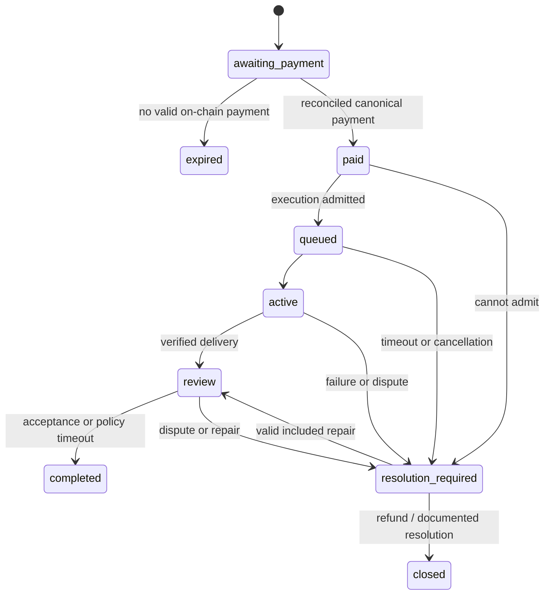

# M03 — Commerce and Pricing

**Status: planned specification.** Owns immutable commercial terms, buyer consent, orders and scope changes. Release one supports fixed-price tasks and bounded sessions only.

## Features

- Resolve admitted listing/capability/variant prices and output promises.
- Produce an expiring immutable quote with all fees and cancellation/refund terms.
- Require explicit confirmation and persist one order before generating its payment ticket.
- Recover the same order across web/MCP, retries, wallet rejection and page refresh.
- Activate paid access only after M06 proves canonical payment.
- Track completion, included repairs and new-scope revision orders separately.

## Quote contract

A quote binds `quoteId`, `orderId`, buyer application ID, payer address, chain ID, router address, treasury address, token, integer amount, fee policy, listing/manifest/capability/variant versions, input/brief/context commitments, output/check profile, execution duration, review duration, turn limits, repair limits, cancellation/refund policy version and expiry.

Private fields stay off-chain; a salted canonical terms commitment binds the public payment ticket to the full quote. Serialization and hashing must have versioned cross-language test vectors. The UI renders the exact persisted quote, not a regenerated model summary.

A quote is valid only for the admitted version and allowed payer. Price or scope edits require a new quote. One quote funds at most one order. A rejected wallet prompt leaves the same unpaid order recoverable until expiry.

## Order lifecycle

Refund and payout states remain separate M06 dimensions. `closed` does not mean a refund transfer succeeded. A late indexer may correct an expired application projection to `paid` when inclusion was before ticket expiry; preserve the correction audit and resolve delivery obligations.

## Proposed commands and consistency

`createQuote`, `confirmQuote`, `getOrder`, `requestCancellation`, `requestRepair`, `createRevisionQuote`. HTTP surfaces: `/v1/quotes`, `/v1/orders`, `/v1/orders/:id/cancellation`, `/v1/orders/:id/repairs`.

The buyer-scoped `operationId` and request fingerprint have a durable uniqueness constraint. Same key/same request returns the record; same key/different terms conflicts. Quotes and operation records survive payment-ticket and browser cache expiry. An order does not change payer after payment.

After payment, one transaction creates executable access, initial run and outbox item. Capacity is checked again. Capacity estimates before payment are not reservations unless explicitly persisted with an expiry. A paid but unavailable provider queues within the quoted deadline or triggers a refund entitlement; money cannot be ignored because admission changed.

## Pricing, repairs and refunds

Prices are integer token units; display exact decimal conversion without floating-point accounting. The buyer total includes a disclosed fee. Proposed accounting: `netSale = paid - refunded`; `platformFee = floor(netSale * feeBps / 10000)`; `providerGross = netSale - platformFee`. Fee version is pinned and fractional dust stays in providerGross under this formula.

Before payout, refunds reduce unpaid earnings and fee revenue using compensating journal entries. After payout, the platform must fund buyer refunds and record provider recovery separately; it must not pretend an old payout was reversed.

An included repair retains the order and price but creates a separately identified repair run. Only one active run per order; finite count and agreed deadline extension. New scope requires a new quote with `parentOrderId`/artifact reference. Transport retries, downloads and status reads are free.

## Acceptance conditions

Concurrent confirms create one order; replay cannot pay twice. Changed terms/payer are rejected. Valid late-indexed payments recover correctly. Capacity loss after payment creates a visible obligation. Repair counters and deadlines cannot be bypassed by reconnect or new message IDs. Every checkout amount matches its ticket and accounting formula.
