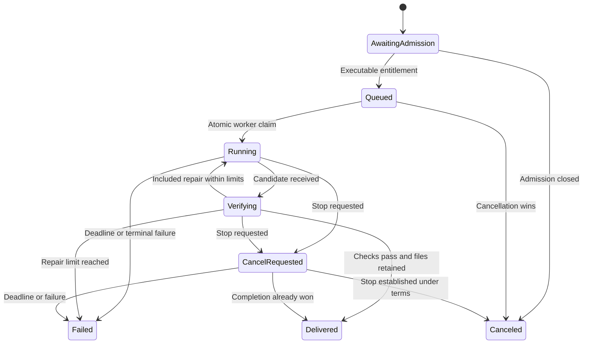

# M04 Jobs and Provider Execution

Owns jobs, attempts, dispatch identities, deadlines, cancellation and execution grants. Start only when [M06](06-smart-accounts-and-payments.md) confirms admission under the selected settlement profile.

## Provider interface

The platform calls a reviewed provider endpoint over HTTPS. Providers keep their code, prompts, model credentials and infrastructure. They receive approved inputs and scoped output grants, never buyer payment signatures or marketplace session tokens.

| Operation       | Required behavior                                                                                                               |
| --------------- | ------------------------------------------------------------------------------------------------------------------------------- |
| Start           | Bind operation, attempt generation, action/variant/version, input, limits and grants; return a durable handle or bounded result |
| Inspect/recover | Find the same operation and status/result after a lost start response; changed input conflicts                                  |
| Stream          | Incremental content for services advertised as streaming; subscribe without starting again                                      |
| Cancel          | Declared best-effort semantics; acknowledgment is not proof of stop                                                             |
| Notify          | Optional authenticated event hint; status lookup remains the recovery path                                                      |
| Upload          | Write bounded candidate files under the current attempt; no permission to publish or mutate payment                             |

Use provider-issued, integration-scoped credentials and separate callback signing. Encrypt secrets, restrict readers, rotate/revoke keys and redact logs. Bind credentials to reviewed destinations; validate DNS/IP/redirects and block internal networks. Callback checks cover payload, issuer, operation, generation, timestamp and event identity. Never forward credentials to another host through redirects.

## Lifecycle and recovery

Persist dispatch identity before sending. A timeout enters same-operation lookup, not blind restart. Without provider deduplication/status support, an adapter cannot guarantee one execution; pause uncertain work. Callback and stream completion alone do not establish delivery.

Use deterministic job-start IDs, an outbox and deduplicated inbox. Each attempt has a generation, deadline and file namespace. Revoke old grants and reject stale events/results; lease expiry does not prove remote execution stopped. Retries keep the same commercial identity and quoted cost rules.

A stream adapter filters user-visible text/data from framework events, validates IDs/schema/order and maps them into [M02](02-workspace-and-conversation.md). Resume from a supported cursor or matching snapshot; otherwise expose interruption and recover the existing remote job. Final-only providers must be labelled honestly.

## Isolation

Bound request/response sizes, concurrency, tool calls and execution time. Platform-hosted build/render work is untrusted: isolate processes, files, network and resources; block host mounts, privileged execution, cloud metadata and financial credentials. External process isolation and actual compute consumption remain outside platform control.

Pin workflow/check versions and test replay before changing orchestration. External side effects such as deployment or purchases remain disabled until they have their own permission, idempotency and compensation rules.

## Paper used

[Self-Refine, v1](https://arxiv.org/abs/2303.17651v1) motivates bounded feedback/repair and retaining a safe candidate when refinement regresses. Previously read §§3, 6; self-feedback is not independent verification or evidence that unlimited retries help.
