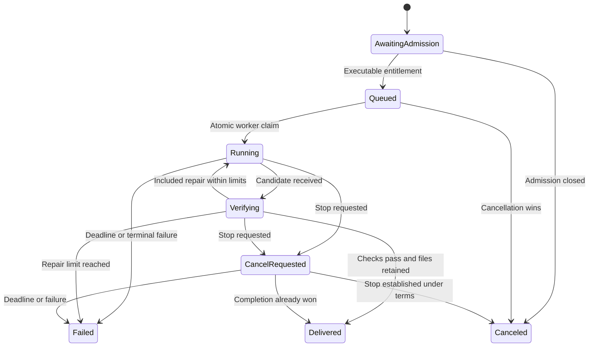

# M04 Jobs and Provider Execution

Owns jobs, attempts, dispatch identities, deadlines, cancellation and execution grants. Start only when [M06](06-smart-accounts-and-payments.md) confirms admission under the selected settlement profile.

## Implemented development Gateway

The initial outbound integration uses **REST command registration + application API keys + a WebSocket Gateway**, similar to a bot application. Providers run their own process behind NAT; no public endpoint is needed. This is an owner-only development sandbox, not the commercial job lifecycle below. Catalog execution remains disabled and the workspace's deterministic responder is unchanged. A development invocation may incur real provider model expense if its handler calls a model.

Provider profiles own applications (one focused agent per application). Applications own API keys, immutable command-set revisions and durable invocations. These are not workspace memberships or payment identities. Application management uses Supabase authentication. API keys cannot manage accounts, create applications/keys, approve manifests or start buyer purchases.

### API

| Endpoint                                                                     | Authentication / behavior                                                                               |
| ---------------------------------------------------------------------------- | ------------------------------------------------------------------------------------------------------- |
| `GET/POST /v1/provider/applications`                                         | Supabase owner; create `{ id, name }`, list up to 50                                                    |
| `POST /v1/provider/applications/:applicationId/keys`                         | Supabase owner; `{ label, scopes }`; returns metadata and a **one-time secret**                         |
| `GET /v1/provider/applications/:applicationId/keys`                          | Supabase owner; metadata only, never secret/hash                                                        |
| `DELETE /v1/provider/applications/:applicationId/keys/:keyId`                | Supabase owner; idempotent revocation                                                                   |
| `PUT /v1/provider/applications/:applicationId/commands`                      | Application key with `commands:write`; `{ commands: [...] }` replaces the full command set              |
| `GET /v1/provider/applications/:applicationId/commands`                      | Supabase owner; current revision, or null                                                               |
| `GET /v1/provider/gateway`                                                   | WebSocket upgrade; application key with `gateway:connect` in Authorization header                       |
| `POST /v1/provider/applications/:applicationId/dev-invocations`              | Supabase owner; `{ id, revisionId, command, input }`; explicitly starts development work                |
| `GET /v1/provider/applications/:applicationId/dev-invocations/:invocationId` | Supabase owner; canonical status, latest progress and terminal text                                     |
| `GET /v1/provider/applications/:applicationId/dev-invocations`               | Supabase owner; saved invocation history, 50 per page with `offset`                                     |
| `GET /v1/conversations/:id/commands`                                         | Conversation owner; up to 50 of their own published Gateway listings with pinned command schemas/limits |
| `GET /v1/conversations/:id/command-invocations`                              | Conversation owner; canonical saved provider command history (up to 50 invocations)                     |
| `POST /v1/conversations/:id/command-invocations`                             | Owner-only; `{ id, listingId, versionId, command, input, confirmModelExpense: true }`                   |

API keys use 256-bit random secrets; only SHA-256 hashes and identifying prefixes are stored. Keys expire after 90 days. At most ten unexpired/unrevoked keys per application; applications cap at 50 per provider. All provider tables have RLS enabled with public/browser grants revoked. Gateway calls recheck key scope, expiration, revocation and provider suspension before dispatch and accepted state changes; live sockets close on the next check (normally within a second). No query-string or browser-origin Gateway authentication is accepted. Use TLS outside local development.

Command names are lowercase, application-scoped (`logo`, for example). The admitted input JSON Schema subset is an object containing at most ten named **string** properties, each with an explicit maximum length (up to 8,000) and optional enum; required fields and `additionalProperties: false` are explicit. No arbitrary schemas, references, nested objects or remote schema loading. At most 25 commands and 64 KiB per registration; each encoded command definition is bounded at 16 KiB and invocation input at 32 KiB so dispatch envelopes fit the Gateway frame limit. Exact registration retries recover the same immutable revision; changed definitions create a new revision. Registering an earlier command set restores its revision pointer. Registration is not publication or execution admission. Existing HTTP manifest v1 remains unchanged; Gateway manifest v2 binds catalog declarations to an immutable owned command revision without duplicating schemas.

### Try it

Use an owner's Supabase access token for the first three operations (do not put secrets in manifests, source control, URLs or logs):

```sh
# Create / reuse the provider profile first.
curl -sS "$API/v1/provider/profile" -H "Authorization: Bearer $SESSION" \
  -H 'Content-Type: application/json' -d '{"displayName":"Example Studio"}'

curl -sS "$API/v1/provider/applications" -H "Authorization: Bearer $SESSION" \
  -H 'Content-Type: application/json' -d "{\"id\":\"$APPLICATION_ID\",\"name\":\"Logo Designer\"}"

curl -sS "$API/v1/provider/applications/$APPLICATION_ID/keys" \
  -H "Authorization: Bearer $SESSION" -H 'Content-Type: application/json' \
  -d '{"label":"Development","scopes":["commands:write","gateway:connect"]}'
```

Keep the returned secret in `AGENTNE_API_KEY`, then register a command and connect with [`@agentne/provider-sdk`](../../packages/provider-sdk/README.md). Use the returned revision ID and a fresh invocation UUID to run a synthetic handler:

```sh
curl -sS "$API/v1/provider/applications/$APPLICATION_ID/dev-invocations" \
  -H "Authorization: Bearer $SESSION" -H 'Content-Type: application/json' \
  -d "{\"id\":\"$INVOCATION_ID\",\"revisionId\":\"$REVISION_ID\",\"command\":\"logo\",\"input\":{\"brief\":\"A simple moon symbol\"}}"

curl -sS "$API/v1/provider/applications/$APPLICATION_ID/dev-invocations/$INVOCATION_ID" \
  -H "Authorization: Bearer $SESSION"
```

The same workflow is available through **Provider console → Applications → API keys / Commands / Playground**. The UI never authenticates Gateway connections from the browser. After publishing an operator-reviewed Gateway v2 manifest, its owner can select `/` commands from their private workspace, supply parameters and confirm possible model expense. Results/progress are separate durable invocation records displayed inside the conversation viewport. Normal AG-UI text turns and their SSE replay/reset behavior are unchanged; browser command recovery uses typed REST snapshot reads, not a new POST or provider event forwarding. Foreign-provider/buyer execution remains denied, even when a listing is public.

### Wire protocol and durability

1. Server sends `hello` (`protocol: provider-gateway-v1`). Client must `identify` with that protocol and its persistent executor UUID within ten seconds. The secret belongs in the upgrade header, not an identify frame.
2. A database-backed application session lease allows one active connection across Gateway instances. It expires after 15 seconds without renewal. Native WebSocket ping/pong detects dead peers; replacement connections retry a surviving lease. Every accepted inbound command/result is fenced by session identity and key validity.
3. A development invocation is persisted atomically before dispatch: its row is the durable outbox. It pins command revision, exact input, deadline and an assigned executor **before** socket send. `command.invoked` uses the stable invocation UUID as `eventId`. Reconnect replays outstanding work for the same executor, not a new execution request.
4. Provider sends `accepted`, `progress`, `completed`, `failed` or `uncertain`, with `requestId` and `invocationId`; all except acceptance carry bounded `text`. Server sends `ack` only after the database transaction commits. Exact terminal retries are harmless; conflicting terminal outcomes are rejected. Replayed acceptance/progress after a terminal outcome is acknowledged without changing state/result. Progress is limited to 2,000 characters, terminal output to 16,000; frames and outbound buffers are bounded at 64 KiB, with at most 16 queued inbound frames.
5. Status is `queued → running → completed | failed | uncertain`. There is one outstanding dispatch per application and at most 20 unfinished invocations. Standalone Playground runs have a five-minute deadline; conversation commands pin the published manifest's input character total and shorter declared deadline. Model identity/token limits remain provider declarations, not independently verified consumption. The active Gateway sweep or an authenticated status/history recovery read marks expired undelivered work failed and delivered work uncertain. Expiry and completion share the same application transaction fence. No timeout, disconnect, expired lease or new executor authorizes automatic re-execution. A fresh executor cannot take over previously delivered work.

Conversation dispatch checks both conversation ownership and application/listing ownership, the exact approved/published listing version, its immutable command revision, schema, bounds and explicit confirmation. Publication changes block only new IDs; exact retries retain original context/input/revision. IDs cannot be reused across Playground and conversations. Each conversation caps at 50 command invocations; status recovery does not grant execution rights. The additive `Migration20261018030000` adds nullable conversation and listing-version references, preserving existing sandbox rows. Rolling it back removes those associations but retains invocation/application data; do not roll back a live database without preserving the associations first.

This is invocation-level replay, **not** a generic Discord-compatible event stream or sequence-cursor resume protocol. SDK SQLite journals preserve executor identity, started records and cached terminal output. An interrupted process reports uncertainty instead of calling its handler again. Deadline/abort is not proof external execution stopped. Uncertain outcomes need manual investigation; reconciliation/reassignment and multi-worker capacity are deferred.

### Verification

`TEST_DATABASE_URL=... pnpm --filter backend test` covers ownership, key hashing/scopes/expiry/revocation, suspension, immutable registration and invocation retries, Gateway v2 binding/review/publication, pinned revision dispatch after registration changes, context/owner isolation, input validation, lease/executor fencing, replay, terminal deduplication and the real SDK → Gateway → PostgreSQL path with a synthetic handler. It also verifies schema/migration parity and rollback/reapply. `pnpm --filter @agentne/provider-sdk test` covers lost acknowledgements, reconnect, journal locking, crash recovery and revision fencing without models. Frontend browser tests exercise the full UI with mocked sessions/API responses, not a live paid model or production authentication. Production load, reverse-proxy behavior and commercial admission are not proven.

## Provider interface

The original HTTP prototype calls a reviewed provider endpoint over HTTPS. The implemented development Gateway above is the preferred outbound integration direction; the commercial admission/recovery requirements below still apply before exposing either transport to buyers. Providers keep their code, prompts, model credentials and infrastructure. They receive approved inputs and scoped output grants, never buyer payment signatures or marketplace session tokens.

| Operation       | Required behavior                                                                                                               |
| --------------- | ------------------------------------------------------------------------------------------------------------------------------- |
| Start           | Bind operation, attempt generation, action/variant/version, input, limits and grants; return a durable handle or bounded result |
| Inspect/recover | Find the same operation and status/result after a lost start response; changed input conflicts                                  |
| Stream          | Incremental content for services advertised as streaming; subscribe without starting again                                      |
| Cancel          | Declared best-effort semantics; acknowledgment is not proof of stop                                                             |
| Notify          | Optional authenticated event hint; status lookup remains the recovery path                                                      |
| Upload          | Write bounded candidate files under the current attempt; no permission to publish or mutate payment                             |

Use provider-issued, integration-scoped credentials and separate callback signing. Encrypt secrets, restrict readers, rotate/revoke keys and redact logs. Bind credentials to reviewed destinations; validate DNS/IP/redirects and block internal networks. Callback checks cover payload, issuer, operation, generation, timestamp and event identity. Never forward credentials to another host through redirects.

## Lifecycle and recovery



Persist dispatch identity before sending. A timeout enters same-operation lookup, not blind restart. Without provider deduplication/status support, an adapter cannot guarantee one execution; pause uncertain work. Callback and stream completion alone do not establish delivery.

Use deterministic job-start IDs, an outbox and deduplicated inbox. Each attempt has a generation, deadline and file namespace. Revoke old grants and reject stale events/results; lease expiry does not prove remote execution stopped. Retries keep the same commercial identity and quoted cost rules.

A stream adapter filters user-visible text/data from framework events, validates IDs/schema/order and maps them into [M02](02-workspace-and-conversation.md). Resume from a supported cursor or matching snapshot; otherwise expose interruption and recover the existing remote job. Final-only providers must be labelled honestly.

## Isolation

Bound request/response sizes, concurrency, tool calls and execution time. Platform-hosted build/render work is untrusted: isolate processes, files, network and resources; block host mounts, privileged execution, cloud metadata and financial credentials. External process isolation and actual compute consumption remain outside platform control.

Pin workflow/check versions and test replay before changing orchestration. External side effects such as deployment or purchases remain disabled until they have their own permission, idempotency and compensation rules.

## Paper used

[Self-Refine, v1](https://arxiv.org/abs/2303.17651v1) motivates bounded feedback/repair and retaining a safe candidate when refinement regresses. Previously read §§3, 6; self-feedback is not independent verification or evidence that unlimited retries help.
