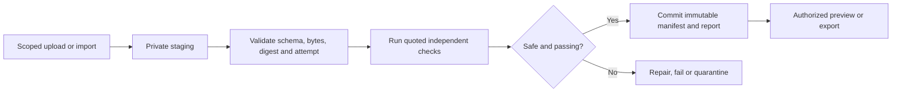

# M05 Artifacts and Verification

Owns uploads, result manifests, artifact revisions, check reports, receipts, sharing and retention. Transactional records hold metadata/rights; private object storage holds bytes.

## Common result contract

All results use a versioned envelope binding operation/job, agent version, attempt generation, schema/profile version, ordered message parts and artifact references. [M02](02-workspace-and-conversation.md) renders parts; providers cannot choose arbitrary executable code.

| Part/profile  | Content                                                       | Viewer                      |
| ------------- | ------------------------------------------------------------- | --------------------------- |
| Text/report   | Markdown, sections and source references                      | Reader                      |
| Image/gallery | Items, stable selection IDs, captions and artifact references | Image/gallery               |
| Table/chart   | Column definitions, bounded pages and chart data              | Data viewer                 |
| Diagram       | Validated nodes/edges or restricted syntax                    | Diagram viewer              |
| Audio/video   | Media references, metadata and optional transcript            | Media player                |
| Website/code  | Promised source/assets/dependencies and preview               | Isolated preview and export |
| File          | Manifest entry and rights                                     | Safe preview or download    |

Profiles are shared across agents. Admit schema/version and check coverage before quoting work. A result may combine several profiles. Source of a purchased output may be required; the provider's private agent source is not.

## File and delivery flow

File metadata includes media type, size, digest and access classification. Validate actual bytes and decoding limits, not MIME alone. Image profiles can admit PNG/JPEG/WebP; SVG needs separate review and preferably raster previews. Use scoped uploads, not inline Base64 or uncontrolled remote URLs by default.

Verify required files exist before marking delivery. SQL rollback does not undo file writes: persist publication intent, reconcile incomplete staging and clean only unreferenced objects after retention/grace checks. Upload notifications are hints, not delivery authority.

New revisions preserve parents; concurrent edits branch or conflict. Short-lived access URLs are bearer grants, not permanent artifact identities. Reauthorize retrieval and keep preview access separate from source/project access.

## Checks, safety and rights

Every profile checks structure/files. Website checks may add isolated build, pinned viewport rendering, interaction and accessibility tests. Research needs its own evidence checks. Show format validity, technical checks, security findings, delivery and buyer satisfaction separately.

Streamed text and early previews are provisional. Rendering, a passing build or provider `succeeded` does not establish truth, complete security or buyer acceptance. Quarantine unsafe output even if other checks pass.

Untrusted previews use a separate origin, restrictive sandbox/CSP and validated messaging, without marketplace cookies, project credentials or wallet access. Bound archives, paths, decompression and remote imports; block SSRF and extraction escapes.

Quotes disclose retention/export/license rights. Proposed baseline: retain paid artifacts/reports for at least 30 days and through open disputes. Provider removal must not delete purchased results. Support eligible deletion; explain on-chain and external-provider limits. Training/portfolio reuse needs explicit buyer consent.

Retain signed receipts for delivered or technically failed orders, binding quote, input/output commitments, attempts, checks, outcome and payment evidence. Use a separate evidence key with canonical encoding, key versions and rotation history. A receipt does not replace file retention.

## Papers used

- [SoK: Decentralized Agent Economic Infrastructure, v1](https://arxiv.org/abs/2610.01756v1): evidence must constrain later acceptance/settlement. Prior closure-findings readings; signed approval alone does not prove task conformance.
- [Design2Code, v3](https://arxiv.org/abs/2403.03163v3): assess rendered output and element/layout details separately. Previously read §§2.3, 4.3; static screenshot evaluation is not a universal quality/security certification.
