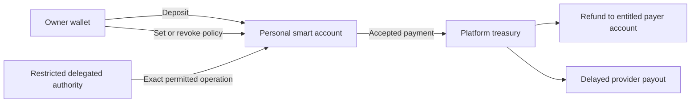
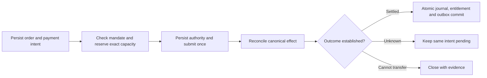

# M06 Smart Accounts and Payments

Owns account/payment bindings, usage-policy integration, reservations, settlement evidence, journal, earnings, refunds and payouts. The contract enforces spending authority; off-chain records track orders and financial obligations. The demo uses Fuji test assets only.

## Implementation status

[`packages/contracts`](../../packages/contracts/README.md) is a Hardhat 3 / OpenZeppelin prototype with Fuji chain ID 43113 configuration. It implements one owner-controlled ERC-20 account per wallet, deposits, owner withdrawal of unreserved balance, bounded delegate policies for one token/recipient/action, aggregate capacity reservation, expiry/revocation, single-use operation IDs and immediate exact-token transfers. Local EVM tests cover account separation, delegated limits, replay and reserved withdrawals. It is not deployed or tested on Fuji. The delegate-supplied quote digest is an event field, not independently checked against M03; no marketplace API invokes `pay`. Fuji test USDC is selected as the target asset, but there is no deployed account/token-route proof, treasury binding, account ownership linkage to Supabase, signed quote authorization, x402 facilitator, chain finality reconciliation, journal, refund, payout or production payment worker. M03 quotes still use test credits; order intents have `paymentEnabled: false` and cannot dispatch jobs. The remainder of this document is the target design, not an implemented payment flow.

## Selected Fuji payment profile

Use Circle **test USDC** on Avalanche Fuji (chain ID `43113`, x402 v2 network `eip155:43113`), token `0x5425890298aed601595a70AB815c96711a31Bc65`, with 6 decimals. Quote and journal amounts must be integer micro-USDC. This is a testnet asset only; the treasury address remains unset. Bind the token address, chain, recipient and amount to the persisted quote/order and issued payment requirement; reject any response that changes them. The order commitment and authorization identity must also be bound and recovered across retries. [Avalanche's Fuji USDC reference](https://build.avax.network/academy/avalanche-l1/native-token-bridge/01-erc20-to-native/04-deploy-erc20-token-home) supplies the address and decimals; the [x402 v2 specification](https://github.com/x402-foundation/x402/blob/main/specs/x402-specification-v2.md) defines the network identifier and facilitator capability discovery.

The intended fixed-price route is x402 v2 `exact` with one upfront USDC settlement. Its default EVM transfer method is EIP-3009, which requires a signature from the token payer address. An owner EOA could sign for USDC held in that EOA, but that would bypass the personal-account balance and delegated policy, so it is **not** an accepted substitute for this product's account-funded route. The current `PersonalAccount` implements neither EIP-3009 signing nor ERC-7710 delegation. The [x402 EVM exact specification](https://github.com/x402-foundation/x402/blob/main/specs/schemes/exact/scheme_exact_evm.md) describes ERC-7710 as a smart-account transfer method; using it requires a compatible account, delegation manager, constrained permission context and a facilitator that actually supports that combination on Fuji. Treat that as the candidate integration, not a completed compatibility claim.

Before enabling payment, select a Fuji facilitator and check its live `/supported` response for x402 v2 `exact` on `eip155:43113`. Verify the required ERC-7710 transfer method separately with that facilitator, then prove its verify/settle route against the exact Circle test USDC contract and account policy. The protocol's example `/supported` response is not evidence for a particular provider or transfer method. Keep M03's test-credit quotes and payment gate until the treasury, authorization, order state and reconciliation path are implemented and tested.

## Personal account and usage policy

Each buyer owns a separate smart account controlled by their wallet. A shared factory may create accounts, but balances and policy state stay separate. There is no shared prepaid vault. Create once and reuse for later deposits; login alone does not create or fund it.

Deposits increase token balance, not permission to spend. The user grants allowed token/chain/recipient/action scope, per-operation ceiling, aggregate budget, expiry and revocation. Delegation may execute matching quotes without a new owner signature each time. It cannot change root policy, redirect funds or withdraw the account balance. Owner keys stay in the wallet.

Show balance, submitted/settled spend, outstanding reservations and unused authority separately. Reserve maximum exposure atomically before issuing usable authority; concurrent jobs share the same cap. Owner withdrawal/recovery must account for live authorizations and prevent double use. Pause cannot erase vested withdrawal/refund rights or reverse settled transfers.

The candidate signature-based design registers structured economic fields and an order commitment, recomputes the exact digest and reserves capacity in a state-changing operation. Read-only contract-signature validation accepts only registered active authority; no generic-signature fallback may bypass it. Enforce unique commercial commitments and single-use nonce/effect identities on the actual token route.

Start with non-recycling commitment capacity. Releasing it requires permanent invalidation and proof of non-use; a consumed nonce may also mean cancellation. Refunds/deposits do not automatically restore authority or reactivate revoked digests. A policy epoch change cannot bypass a promised lifetime cap.

## Settlement and metered billing

x402 `exact` moves a known amount. The fixed-price candidate uses explicit upfront settlement before paid execution. Persist order, exact authorization and submission identity first; one adapter/worker owns settlement. Never combine independently settling middleware and workers.

Metered/hybrid sales are proposed and need a selected collection policy:

| Option                             | Money path                                                    | Limitation                                                                                 |
| ---------------------------------- | ------------------------------------------------------------- | ------------------------------------------------------------------------------------------ |
| Upfront ceiling, refund difference | Settle the maximum, rate accepted usage, refund the remainder | Temporary overcollection, refund transactions and funded treasury liabilities              |
| Reserve then capture actual cost   | Enforce a reserved ceiling and settle accepted usage later    | Requires separately proven contract/client/facilitator support; reservation is not payment |

Neither option is silently supplied by `exact`. Do not enable metered admission until usage evidence, error/cancellation billing and collection/recovery semantics are agreed. Missing usage does not justify charging the ceiling. [M03](03-commerce-and-pricing.md) owns rates and accepted usage; M06 enforces money limits and postings.

For upfront profiles, execution starts only after the settled effect is recorded. SQL and chain writes are not atomic; recover the gap. Verify chain/token/payer/recipient/amount, authorization, successful receipt, effect identity and finality. A facilitator response, transaction hash or verification success is insufficient. Timeouts retain the original authorization; no fresh nonce or facilitator-switch charge while the first can settle.

## Treasury and compensation

Unspent deposits stay in personal accounts. Paid order funds enter the disclosed platform treasury. This is direct payment with operator obligations, not job-acceptance escrow. Providers do not receive buyer authorizations or implement x402 by requirement.

Use append-only double-entry postings per chain/token. Settlement creates an order liability; accepted delivery allocates pending provider earnings/fees; release waits for quoted dispute holds. Refund and payout have separate approval, submission, reconciliation and unique effects. Never withdraw refundable liabilities; a multisig alone cannot enforce off-chain holds.

The fixed-price proposal refunds technical failure/deadline breach in full, including fees. Pre-claim cancellation closes execution atomically and refunds a settled order; running cancellation follows disclosed terms. Metered failure billing is a separate decision, not an implicit exception to fixed-price terms. Subjective decisions require a named human or mutual agreement and cannot allocate more than funded liabilities/reserves. Late compensation after payout needs real reserves.

## Proof still required

Test the complete owner/account/delegate/token/facilitator route on Fuji, including concurrent caps, revocation races, replay, withdrawal, contract-signature bypasses, gas and restoration. Token authorization routes may bypass ordinary account execution guards. Separate account ownership from the payer address; unsupported routes must not fall back to unguarded wallet payments.

If standard x402 cannot enforce this policy, choose an explicitly custom tested profile or defer paid use. Job escrow/capture is a separate design. Confirm organizer custody/treasury and chain requirements before enabling settlement.

## Papers used

- [A Formal Analysis of Agent Payment Protocols, v1](https://arxiv.org/abs/2609.00060v1): durable identity and authorization/effect correspondence. Prior targeted readings; no proof of this integration.
- [Authority-Inference Separation in Agentic Finance, v1](https://arxiv.org/abs/2608.30519v1): deterministic grants separate from AI proposals. Prior section readings; prototype evidence is not production enforcement.
- [AgentValve, v1](https://arxiv.org/abs/2610.12948v1): finite capacity and atomic reservation. Prior feedback/timeout/discussion readings; its trust graph is not adopted and snapshot exposure is not lifetime loss.
- [When HTTP 402 Meets the Blockchain, v1](https://arxiv.org/abs/2607.19545v1): independently reconcile settlement and constrain facilitator/sponsor exposure. Prior Discussion reading; reported deployment weaknesses may have been fixed.
