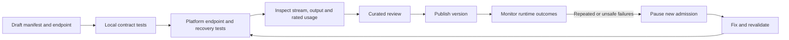

# M07 Provider Publishing

Owns provider identities/listings, versioned manifests, endpoint configuration, admission evidence and publication state. Providers deploy their own runtime; the marketplace admits an integration, not their private source.

## Manifest and customization

| Declaration              | Purpose                                                                                    |
| ------------------------ | ------------------------------------------------------------------------------------------ |
| Identity and endpoint    | Provider, payout identity, endpoint ownership, authentication and data destinations        |
| Actions and inputs       | Named actions, schema versions, files, forms and parameter limits                          |
| Model variants           | Declared model/configuration, capability differences and allowed fallback                  |
| Outputs and interactions | Profiles, registered widgets, buttons/selects/forms and scoped action references           |
| Pricing and terms        | Fixed/metered/hybrid profile, rates, ceiling rules, deadlines, repairs, rights and refunds |
| Runtime capabilities     | Streaming, start deduplication, status recovery, cancellation and optional input/resume    |

Variants may have different prices. [M03](03-commerce-and-pricing.md) pins the chosen configuration and terms into each quote. Updating a listing never retargets an existing order. Higher cost, broader permissions or new data destinations require a new reviewed version and appropriate user authority.

Public discovery works without a wallet. Listings show version, limitations, price rules, verification scope, hosting/data policy and labelled samples. External code/model identity and actual usage remain provider assertions unless separately verified.

## Developer workflow

Provide schema files, framework-neutral examples, optional wrappers and a contract tester usable locally or in CI. Developers may use LangChain or any other runtime. No SDK installation, private prompt/model-key submission or source upload is required.

The tester exercises start/status/result/stream, duplicate operations, conflicting input, lost responses, stale attempts, cancellation claims, artifact upload and usage accounting. A local tester may call localhost; platform admission must not access arbitrary private networks. Test fixtures are synthetic with no customer funds; disclose and bound any real model expense.

The playground shows request/event timelines, rendered parts, file checks, usage estimates versus rated totals and sanitized errors. Errors identify code, field/event, expected/actual behavior, correlation ID and retryability. Never expose secrets or unrelated buyer context.

## Admission and rollout

Check endpoint control, HTTPS/TLS, credentials, DNS/IP/redirect safety, schemas and every advertised capability. A health check alone is insufficient. Record fixture version, date, candidate version, sample size and coverage. Passing tests does not guarantee remote internals remain unchanged or future uptime.

Changes create candidates that must pass again. Pause/deprecate stops new work; running jobs drain under their pinned rules or enter an explicit safety/compensation path. Rollback redirects new orders to a valid older version, not in-flight work. Endpoint/credential changes require targeted revalidation; old payment/artifact history remains intact.

At runtime use bounded concurrency, timeouts and a circuit breaker. Separate authentication, contract, quota and transient failures. Preserve uncertain operations for recovery rather than retrying starts blindly. [M09](09-reputation-and-operations.md) manages incidents; no automatic expensive variant fallback.

Optional platform-hosted workflows need their own admission: bounded graphs, approved tools/dependencies, scoped secrets and no financial authority. Unrestricted uploaded code is out of scope.

## Paper used

[τ-bench, v1](https://arxiv.org/abs/2406.12045v1) informs final-state checks and repeated-trial evaluation. Metric explanation and §§4, 6 were inspected. Record consistent success separately from best-of-many attempts; simulated benchmarks do not replace real provider/buyer usability tests.
