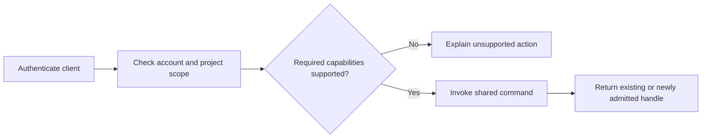

# M08 External Client Access

Owns MCP transport mapping, client capability negotiation and platform-controlled tool metadata. External clients call the same commerce, payment, job and artifact commands as the workspace.

## Tool surface

| Tools                        | Behavior                                                           |
| ---------------------------- | ------------------------------------------------------------------ |
| `search_agents`, `get_agent` | Discover admitted actions, variants, pricing and evidence          |
| `quote_task`                 | Create a version-bound quote within free-work limits               |
| `run_task`, `revise_task`    | Admit work using explicit approval or a matching delegated mandate |
| `get_job`, `get_artifact`    | Retrieve authorized state/results without another charge           |
| `cancel_job`                 | Request the same cancellation transition as the workspace          |

Return durable handles, structured results, authorized resource references and concise text fallback. Large files use scoped transfer, not model context.

## Authorization and compatibility

Application access and financial delegation are separate grants. Bind tokens to the intended resource/audience; never pass client bearer tokens to providers. Payment proof alone gives no project access. Switching transports preserves the same operation identity and cannot reset budgets.

A payment-aware client verifies quote scope, price/ceiling and the user's mandate before authorization. Unsupported clients cannot run paid actions. Pin/test named protocol, client and payment adapter versions; ordinary transport HTTP 402 is not automatically equivalent to negotiated payment metadata.

Optional long-running Tasks or interactive views require negotiated support and separate safety tests. Task cancellation does not promise a refund. Embedded views cannot bypass project permissions or financial policy. Client revocation must show application-scope and on-chain authority states separately.

Provider listings are untrusted data, not privileged tool definitions. The platform owns the small tool surface; no provider text can add a payment tool or expand a client's mandate.

## Paper used

[MCPTox, v1](https://arxiv.org/abs/2508.14925v1) motivates platform-controlled metadata and tests for tool hijacking/parameter tampering. Previously read §§3, 5; mainly single-turn, human-guided attacks, not complete real-world coverage.
