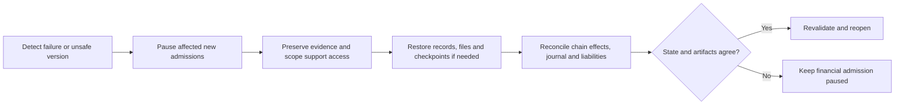

# M09 Reputation and Operations

Owns reviews, public evidence projections, affiliation labels, moderation, support audit and incident queues. [M05](05-artifacts-and-verification.md) owns result evidence; [M06](06-smart-accounts-and-payments.md) owns financial resolutions and transfers.

## Reviews and disputes

Only an entitled buyer can review an order, with one review and an auditable edit history. Label refunded/failed orders. Retries add no reviews; repeated revisions from one project are not independent buyers.

Show reputation by task and agent version: sample counts, recent delivery outcomes, check coverage and buyer opinions. Label provider-uploaded/incentivized samples. Investigate self-purchases and coordinated feedback; avoid rewards based only on transaction volume.

Disputes bind order, artifact revision, reason and evidence. The proposed filing window is 72 hours after delivery, with an initial response target of two business days; these are settings to validate, not measured guarantees. Timely disputes freeze relevant payables. Subjective decisions require an authorized human or mutual agreement, recorded reasons and funded allocation. AI may summarize evidence but cannot approve transfers or penalties.

## Incidents and recovery

Track unknown settlements, outbox/queue lag, provider/stream errors, deadlines, usage anomalies, unavailable artifacts, refund/payout holds and treasury coverage. Correlate quote, order, authorization, job/attempt, artifact and compensation without logging raw signatures, private prompts or credentials.

Operators can pause a provider/token/profile and quarantine output, while preserving safe status, export and refund recovery. Support access is scoped, time-limited and logged. Financial corrections append records; no rewriting settlement history or silent impersonation.

Back up transactional records, object manifests/bytes, necessary signing recovery material and orchestration/checkpoint state under separate access controls. Restore in restricted mode, replay events with deduplication and reconcile against canonical chain evidence before reopening spend. Backups cannot erase charges or make withdrawn provider funds available again. Define and test load/recovery targets before promising an SLA.

## Papers used

- [AgentReputation, v1](https://arxiv.org/abs/2605.00073v1): separate task context, verification strength and opinion. Prior Core Mechanisms/Discussion readings; a conceptual framework, not a validated universal trust score or collusion solution.
- [How Agentic Is Agentic Commerce?, v1](https://arxiv.org/abs/2607.12575v1): transaction counts can be manufactured; measure independent useful delivery. Prior limitations/implications readings; on-chain traces cannot establish all off-chain relationships.
