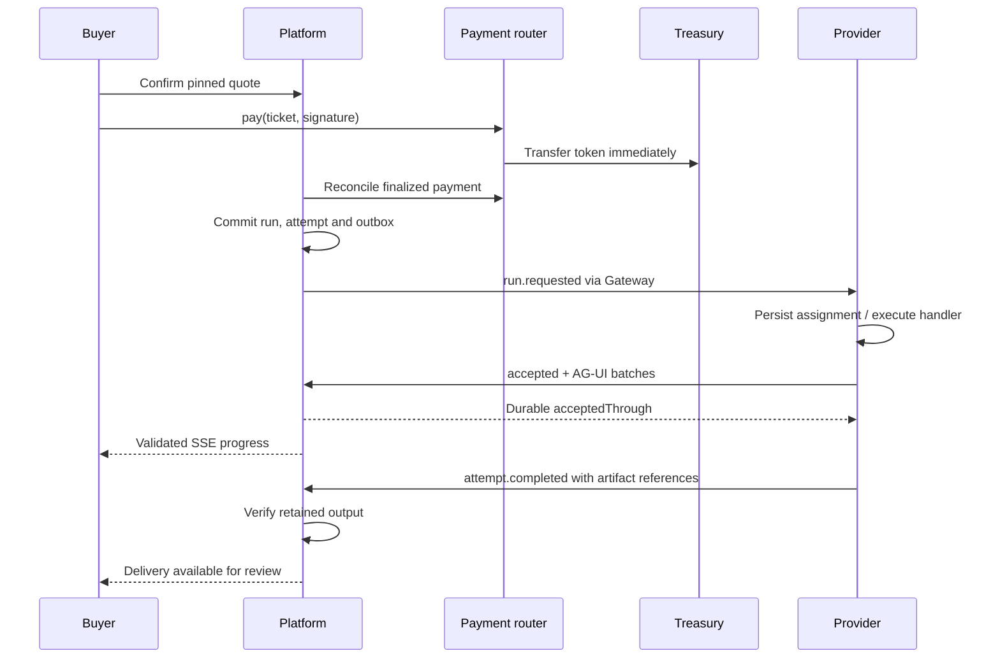

# Provider events, ingestion and browser streaming

**Normative target protocol `agentne/1`.** Transport delivery is at-least-once. Exactly-once external execution cannot be guaranteed by WebSockets; durable identities, SDK journals and recovery constrain duplicates.

## Three separate channels

1. **Platform → provider:** an outbound provider WebSocket carries scoped execution/control events.
2. **Provider → platform:** authenticated HTTP batches of NDJSON carry attempt progress and final reports, with a durable acknowledgment response. Split long generations into bounded batches rather than waiting for one unbounded response.
3. **Platform → buyer:** authenticated SSE projects validated, persisted messages and platform-owned status. Provider bytes are never forwarded unchecked.

Payment/refund/domain outbox events are internal; providers receive only execution-relevant grants. A chat message is a request, not a globally broadcast event.

## Event catalog

| Direction           | Event                                     | Producer condition / permitted effect                                                           |
| ------------------- | ----------------------------------------- | ----------------------------------------------------------------------------------------------- |
| Platform → provider | `run.requested`                           | Paid admission or explicit owner development grant; starts/resumes exactly the assigned attempt |
| Platform → provider | `run.input_submitted`                     | Buyer response/follow-up within session/input-request limits; same run, no new purchase         |
| Platform → provider | `run.cancel_requested`                    | Authorized cancellation request; requires provider terminal/status acknowledgment               |
| Platform → provider | `run.status_requested`                    | Reconcile an existing assignment; must not start work                                           |
| Provider → platform | `attempt.accepted`                        | Assignment journaled; establish acceptance and capacity ownership                               |
| Provider → platform | `attempt.progress`                        | Bounded status text, no financial state change                                                  |
| Provider → platform | `attempt.input_required`                  | A declared interaction schema/request ID; pauses within the same run                            |
| Provider → platform | `attempt.ag_ui`                           | Allowed text/run event subset, mapped to platform IDs                                           |
| Provider → platform | `attempt.completed`                       | Final artifact references and summary; begins verification                                      |
| Provider → platform | `attempt.failed`                          | Structured error code and known side-effect status                                              |
| Provider → platform | `attempt.canceled`                        | Cooperative stop report; no implied refund                                                      |
| Provider → platform | `attempt.uncertain`                       | Cannot establish whether work occurred; requires reconciliation                                 |
| Internal only       | `payment.confirmed`                       | M06 canonical payment journaled; allows admission                                               |
| Internal only       | `delivery.available`, `delivery.accepted` | M05 evidence and buyer decision respectively                                                    |
| Internal only       | `refund.approved`, `refund.confirmed`     | Separate entitlement and chain transfer facts                                                   |
| Internal only       | `payout.confirmed`                        | Separate reconciled treasury transfer                                                           |

Gateway transport frames `hello`, `heartbeat`, `ack`, `error` and `resume` are not domain events. `ack` means durable receipt at its documented boundary, not successful work.

## Dispatch envelope

The following JSON is a schema illustration with fixture values. It intentionally contains no wallet signature, session token or private download URL; file IDs are exchanged for grants after attempt authorization.

```json
{
  "protocol": "agentne/1",
  "eventId": "evt-fixture-1",
  "type": "run.requested",
  "applicationId": "app-fixture-1",
  "streamId": "assignment-fixture-1",
  "sequence": 1,
  "occurredAt": "2026-10-18T10:00:00Z",
  "runId": "run-fixture-1",
  "attemptId": "attempt-fixture-1",
  "fencingToken": 1,
  "payload": {
    "mode": "commercial",
    "orderId": "order-fixture-1",
    "listingVersionId": "listing-version-fixture-1",
    "capabilityId": "logo-concept",
    "capabilityRevision": "rev-1",
    "variantId": "standard",
    "trigger": { "type": "slash_command", "messageId": "message-fixture-1" },
    "input": { "brand": "Example", "brief": "A simple monochrome symbol" },
    "context": {},
    "attachmentIds": [],
    "deadline": "2026-10-18T10:10:00Z",
    "limits": { "maxOutputBytes": 10485760, "maxInputRequests": 0 }
  }
}
```

`run.input_submitted` carries a stable message/input-request ID, selected input and next sequence within the same assignment stream. Never copy unrelated history. File grant responses include name, detected media type, byte size, expiry and a 120-second HTTPS GET URL. URLs are retrieved/renewed through the scoped attempt API rather than stored in replayable domain events.

## Ingestion envelope and acknowledgment

`POST /v1/provider/runs/:runId/attempts/:attemptId/events` accepts `application/x-ndjson`. Each line contains protocol, stable event ID, attempt-local sequence, fencing token, type and typed payload. Example:

```json
{
  "protocol": "agentne/1",
  "eventId": "provider-event-fixture-2",
  "sequence": 2,
  "fencingToken": 1,
  "type": "attempt.ag_ui",
  "payload": {
    "type": "TEXT_MESSAGE_START",
    "messageId": "provider-message-fixture-1",
    "role": "assistant"
  }
}
```

The first ingestion event is `attempt.accepted` at sequence 1. Validate application assignment, active fence, event schema, byte limits and state transition before persisting each contiguous event. Return `acceptedThrough` and terminal status after durable commit. A batch may partially commit: a failed response requires querying `GET .../stream-state` and resending from the accepted high-water mark, with the original event IDs and payloads.

Store a canonical payload digest per sequence. Same sequence/ID/content is harmless; reuse with changed content is a conflict. Gaps return expected sequence; no unbounded reordering buffer. Terminal state accepts exact terminal replay but rejects new progress. An application key with the right scope but wrong assignment is forbidden.

Proposed bounds: 64 KiB per NDJSON line, 1 MiB per request, 10 MiB streamed text per attempt, three buyer subscriptions per account and finite capability runtime. Oversize events produce a typed error without uncontrolled memory buffering. Output artifact byte limits are separate. Tune these defaults through load tests and publish effective limits.

## AG-UI mapping

Allow `RUN_STARTED`, `TEXT_MESSAGE_START`, `TEXT_MESSAGE_CONTENT`, `TEXT_MESSAGE_END`, `RUN_FINISHED`, `RUN_ERROR` in the pinned provider profile. Roles are restricted to `assistant`. The platform validates or maps provider message/run IDs to its own identities.

Reject arbitrary tool calls, raw/custom payloads, state patches, scripts, private reasoning and unnegotiated event types. Structured interaction requests use `attempt.input_required`, not an unrestricted AG-UI tool event. Provider `RUN_FINISHED` completes its stream; `attempt.completed` identifies the final result to verify. Neither means accepted delivery or financial success.

The browser receives a platform-owned AG-UI run lifecycle for each streamed response segment. A commercial session run may contain multiple segments while waiting for input; segment IDs are mapped to the stable commercial run. SDK/client adapters must not interpret a new UI segment as a new paid order. Pin the supported AG-UI library/spec version during implementation; upstream event additions do not automatically enter this allowlist. The [official event reference](https://docs.ag-ui.com/concepts/events) defines transport event families, not marketplace billing semantics.

## Reconnect and crash cases

| Failure                            | Required recovery                                                                                |
| ---------------------------------- | ------------------------------------------------------------------------------------------------ |
| Dispatch ack lost                  | Resend same event/attempt; SDK reads journal before invoking handler                             |
| Provider restarts after model call | Recover durable result/status; if unknowable report uncertain, never start automatically         |
| Ingestion response lost            | Read accepted sequence; replay missing suffix with same identities                               |
| Stale attempt uploads              | Reject active publication; preserve evidence for diagnosis                                       |
| Browser disconnect                 | Read snapshot/cursor and resume SSE; no new message submission                                   |
| Cursor retention expired           | Atomic snapshot with high-water mark and explicit reset, then tail                               |
| Cancellation races completion      | Serialize transition on run; retain late result as evidence but do not invent delivery/refund    |
| Provider key revoked               | Stop new access and dispatch; operator reconciles active assignments under replacement authority |

## End-to-end sequence


